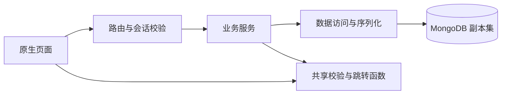
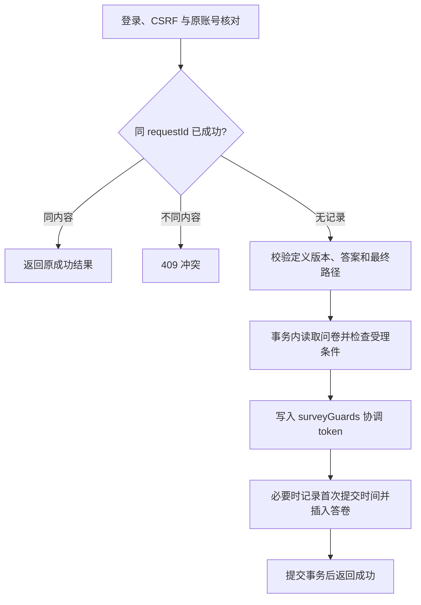

# 系统与关键逻辑

功能规则见 [requirements.md](requirements.md)，接口与存储细节见 [API](api.md) 和 [数据库设计](database.md)。

## 1. 模块结构

单个 Express 应用同源提供静态页面和 JSON API，使用 MongoDB 原生驱动、ES Modules、express-session 与 connect-mongo。

| 目录/入口 | 职责 |
| --- | --- |
| [app.js](../src/app.js) / [server.js](../src/server.js) | 创建应用与监听分离；配置检查、初始化和正常关闭 |
| [services](../src/services/) | 账号、题目版本/共享、题库、问卷管理、提交、统计和删除 |
| [repositories](../src/repositories/) / [serializers](../src/serializers/) | MongoDB 查询、事务操作与响应字段白名单 |
| [shared](../src/shared/) | 前后端共用的纯函数，无数据库、HTTP、DOM 或 Node 专用依赖 |
| [public](../public/) | 页面、交互状态和 API 客户端 |
| [db](../src/db/) / [scripts](../scripts/) | 连接、字段校验、索引和本机数据库管理 |

服务共享 MongoClient 连接池；时钟可注入以验证截止和会话边界。浏览器仅通过专用路径读取共享模块，不公开整个 src。

## 2. 账号、会话与权限

[账号服务](../src/services/auth-service.js)使用随机盐与异步scrypt保存密码，以timingSafeEqual比较；校验编码和参数，拒绝未配对UTF-16代理项，不去空格、截断或Unicode归一化。用户名唯一且区分大小写，输入合同见 [API](api.md#2-账号接口)。

会话保存 userId、issuedAt、absoluteExpiresAt 和 CSRF token，登录时重新生成会话 ID。受保护请求显式检查固定 24 小时期限，不依赖 MongoDB TTL 是否已经清理。Cookie 使用 HttpOnly、SameSite=Lax，Secure 由 HTTPS 配置决定。

写请求验证 CSRF；受保护写操作先检查登录，以便到期返回 401。退出登录销毁会话并清除 Cookie；已有 CSRF token 的读取不保存会话，store.touch 不写数据库，避免读取与退出并发时恢复已撤销的会话。Cookie 和持久化到期时间均对齐固定期限。

填写页遇到 401 保留内存答案和待确认请求，在原页恢复原账号。expectedUserId 用于核对会话，真正的 respondentId 始终来自服务端会话。作者查询按资源 ID 与 ownerId 限定，答卷还须匹配所属问卷；匿名输出使用字段白名单。

## 3. 草稿、修订与冻结

结构校验允许草稿缺少题干、选项或未完成条件，但字段类型及 ID 格式、唯一性必须合法。发布执行完整校验：标题/题干非空、有题目及合法选项、范围一致、规则引用存在且与题型兼容；规则图允许有环。

管理操作按 ownerId 与 revision 条件更新，冲突返回 409。题目定义修改递增 definitionRevision，并要求 contentLocked=false。首次发布同时冻结填写策略和全部题目配置；首份答卷按 firstSubmittedAt=null 判断，并与首次时间同事务保存。标题、说明、截止时间修改不改变题目定义版本。

问卷持久状态为 draft、published、closed；到期由 deadlineAt 动态判断。重新开放必须满足截止要求，延长截止时间不会自动重开 closed 问卷。

### 3.1 独立版本与问卷物化

[题目服务](../src/services/question-service.js)管理不可变版本、父版/另存来源和授权；[题库服务](../src/services/bank-service.js)只管理个人分类。版本序号分配与记录插入在同一事务完成。

[问卷服务](../src/services/survey-service.js)根据版本引用生成固定内容，客户端同时提供的内容必须一致；保留同一实例的相同引用时使用原内嵌内容。新增选用、另存和分类收录真实更新 questions.token，与撤销/归档共同写入，事务重试后重新授权。该约束依赖数据库，适用于多应用实例。

换版保留本地题目ID及局部配置，失效规则可暂存但不能发布。草稿保存临时题时原子关联独立版本；发布后仅导出，不改变原问卷。复制前核验全部引用，发现不可用题目整体回滚；复制/导出通过原问卷guard与永久删除协调。字段和升级约束见 [数据库设计](database.md)，输入输出见 [API](api.md#31-问卷引用导出与复制)。

## 4. 答案校验与最终路径

[答案函数](../src/shared/answers.js)按题型标准化和校验：空答保存为 null，非法类型不转换为空答；数字 0 有效，多选重复项报错，文本按码点计数并保留非空原文。浏览器数字输入须完整合法后才转 number，不能将“12abc”解析成 12。

[规则函数](../src/shared/rules.js)每次只计算一个后继，按规则顺序首条命中，空答不匹配规则，无命中默认下一题。页面答案缓存与实际导航历史独立；“上一题”沿历史返回，继续填写时重建后续导航分支，缓存仍可回填。END 只进入确认页。

[路径函数](../src/shared/path.js)固定最终答案，从第一题重新计算并校验，使用访问集合检测无法结束的路径。同题再次出现返回 PATH_NOT_COMPLETE；这只保证提交复核终止，不限制页面回跳次数。

客户端用 `resolveFinalPath(...,{rejectOutside:false})` 从缓存筛选有效答案；服务端默认严格模式，拒绝未知/重复题目、路径外答案和伪造路径。路径内缺少可选值补 null，缺必答报错，服务端生成 effectivePath。

例如实际访问 Q1→Q2(A)→Q3→Q2(B)→Q4→END，最终只保存 Q1、Q2、Q4。完整访问与修改历史不上传、不持久化。

## 5. 提交、幂等与事务

requestId 是一次主动提交的 UUID，结果未知时保持原标识与负载。摘要包含 definitionRevision、anonymous 和规范化请求答案；题目条目及多选值排序，空值统一 null，非空文本保留原文。缺失整条答案与显式 null 条目视为不同请求，摘要不依赖当前开放状态。

事务前完成答案复核；事务内首次读取问卷时检查 published、截止时间、版本及填写策略，再检查幂等记录，实际更新 guard。首次时间和答卷共同提交或回滚，唯一索引约束幂等与单次填写，不保存问卷累计计数。

受理点是事务读取问卷并检查状态/时间的步骤。关闭前已受理尝试可完成；事务冲突回滚后重新检查，不沿用先前状态。驱动 withTransaction 的回调内顺序 await，使用同一 session，重试保持答卷 ID 和负载稳定，不在回调中发送 HTTP 响应。

并发冲突后在事务外查询同作用域 requestId：同内容成功则重放，否则报告真实冲突。成功请求在问卷仍存在但关闭或到期后仍可重放。没有读到成功记录不代表另一在途事务必然失败；页面已处于结果未知时，后续关闭等错误仍保留原请求确认，不能宣称原提交失败。

## 6. 统计与页面状态

[统计仓储](../src/repositories/statistics.js)先按 surveyId 聚合最终有效答案，整卷指标使用同一 $facet 输入。多选回答数先按答卷计算，再展开选项；补齐零次选项，空分母和空均值为 null。

分页使用 submittedAt、_id 降序与 limit+1，游标绑定问卷及必要题目作用域；每次查询均重新授权，不承诺多次读取为同一数据库快照。只关联本页实名答卷所需用户名，匿名 respondent=null，不返回内部身份、幂等字段或会话。

[统计页面](../public/js/statistics.js)用请求世代丢弃迟到响应，切题重置游标，授权失败或资源消失时清除旧内容。用户文本通过 textContent 展示；数字 0 保留，null 展示“暂无数据”。

### 6.1 版本统计与题库页面

[跨卷统计服务](../src/services/question-statistics-service.js)从submissions关联当前用户拥有的surveys，按reference和本地questionId筛选最终有效非空答案。facet计算分母、均值与选项次数，数字频次分组后分页；回答页只关联实名用户并用白名单输出。已有引用允许查询自己的该版本统计，不开放原题其他历史或他人数据。

[题库页面](../public/js/questions.js)提供内容表单、版本来源、恢复/另存、共享、分类和版本对比；[问卷编辑器](../public/js/editor.js)提供选题、换版、旧题保存及复制。版本内容只读，草稿可改局部必答/跳转。填写输出剥离reference，规则函数只处理普通题目定义。用户文本通过textContent展示，题库页写入前核对账号；结果未知的新建请求不自动重放。

## 7. 永久删除与在途提交

[删除服务](../src/services/deletion-service.js)先按所有权预览，再在事务中重查资格、revision 和精确确认词。draft、closed 或已到期 published 才可删除；预览不锁定资源，答卷数仅代表预览时刻。

每份问卷有一条 [surveyGuards](database.md#survey-deletion-data) 记录。新问卷与 guard 原子创建，所有新增提交真实更新 guard.token，删除事务删除同一 guard、全部答卷和问卷。共同写入引发的事务冲突使删除包含先完成的提交，或使在途提交失败，保证删除后不留下孤立答卷。协调不通过每次提交修改问卷实现，以保持关闭前已受理语义；运行时不得重建缺失 guard。

列表使用原生 dialog，输入“删除”后才启用“永久删除”，发送时核对原账号。网络或服务故障保留待确认状态；204 或原账号下确认目标不存在后更新列表。修订冲突须重新预览确认，不自动覆盖。

已删除问卷统一返回资源 404。填写页停止原请求确认和新提交，管理/统计页清除相关内容并丢弃迟到响应；不承诺已显示页面被远程即时清除。API 客户端记录失败 requestPath，页面只将对应资源的 NOT_FOUND 视为删除，不能把获取 CSRF 的 404 或普通网络错误误判为成功。

## 8. 配置与验证

启动检查配置、数据库连接、副本集及结构兼容性，初始化可重复执行，保留业务内容；可识别旧结构的冻结升级见 [数据库设计](database.md)。错误响应统一为 code、message 和可选 details，不返回数据库堆栈或敏感字段。

测试通过业务时钟和仅在测试装配中传入的事务钩子控制边界，数据库写入、索引和事务仍是真实 MongoDB 操作。运行方式、用例与验证范围见 [测试说明](test-cases.md)。
