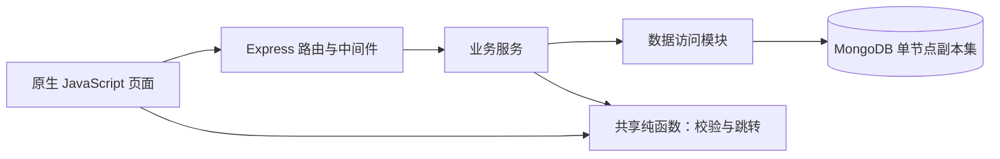
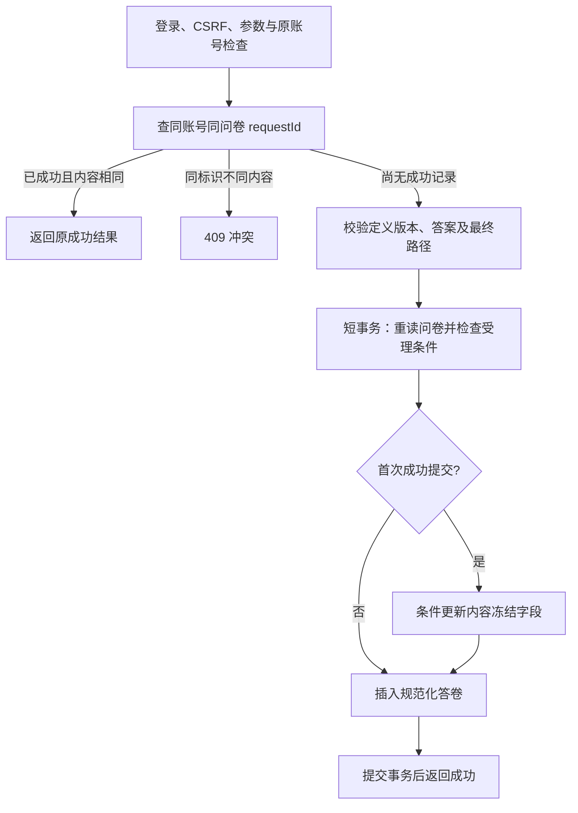

# 后端与关键逻辑设计初稿

依据：[需求](requirements.md)、[数据库设计](database.md)。状态：M1—M3 已验收；已实现应用基础、账号/会话、CSRF、个人列表及问卷管理/定义校验。填写/答案执行、提交与统计保留为后续设计基线，已交付索引及下一步安排见 [M4计划](../workflow/plan.md#m4)，真实证据见 [测试记录](test-cases.md#11-m3-实际执行记录)。

## 1. 本次确认的行为

| 编号 | 决策 |
| --- | --- |
| C1 | 登录后固定 24 小时有效，不随访问续期；Cookie 携带会话标识，会话存 MongoDB |
| C2 | 填写期间登录过期，保留当前页面答案，提示重新登录原账号后重试；不新增服务端续填功能 |
| C3 | 草稿可不完整，但类型和 ID 须合法；发布及首次发布后的题目更新须通过完整校验 |
| C4 | 可选题空答跳过内容限制，非空执行限制；纯空白文本为空，数字 0 有效 |
| C5 | 文本长度按 Unicode 码点计数，组合表情可能计多个码点 |
| C6 | 用户名为中英文文字、数字、下划线或连字符，3—32 个码点，无空白、大小写敏感；密码 8—128 个码点，可含空格，无字符组合要求，不去除空格 |

## 2. 运行结构与模块职责

采用单个 Express 应用，同源提供页面和 JSON API。技术方案选择 MongoDB 原生驱动、ES Modules、express-session 和 connect-mongo；不用 ORM 隐藏查询和事务。版本与依赖兼容性在 M2 安装时核实并锁定。

| 模块 | 职责 |
| --- | --- |
| app.js / server.js | 创建应用与启动监听分离；连接数据库、加载配置、关闭连接 |
| routes | 解析参数、调用服务、返回 HTTP 状态与 JSON，不在路由里堆积规则算法 |
| middleware | 加载会话、验证登录与 CSRF、统一错误响应 |
| authService | 注册、密码验证、会话建立/销毁、固定有效期 |
| surveyService | 所有权、草稿保存、发布/关闭/重开、修订与冻结控制 |
| submissionService | 幂等、最终路径复核、受理、首份冻结和插入事务 |
| statisticsService | 所有权、聚合统计、分页、匿名字段过滤 |
| repositories | 明确的 MongoDB 查询、条件更新与聚合，事务操作传入同一 session |
| shared | 无数据库、HTTP、DOM 或 Node 专用依赖的校验/规则纯函数 |
| serializers | 从内部文档构造允许返回的字段，不直接返回数据库原文档 |

服务共享一份 MongoClient 连接池，不按请求重新连接。时钟作为服务依赖，便于测试截止和到期边界。共享模块可通过专用静态路径提供给浏览器，仅暴露该目录，不公开整个 src。

建议文件按实际实现建立：`src/{routes,services,repositories,middleware,shared,serializers,db}`、`public/`、`tests/`、`scripts/`。不引入通用规则脚本执行器或复杂插件体系。

## 3. 登录、会话与权限

### 3.1 账号

注册按 C6 校验用户名和密码，不对密码 trim、截断或变更 Unicode 表示。用户名不小写化；重复注册由大小写敏感唯一索引兜底。实现使用 Node.js 异步 scrypt，N=32768、r=8、p=1、maxmem=64MiB、随机盐16字节、派生结果64字节；编码为 scrypt$N$r$p$saltHex$keyHex，比较采用 timingSafeEqual。验证编码时只接受当前受支持参数，避免从存储字符串任意放大计算开销。注册和登录均拒绝含未配对 UTF-16 代理项的密码，避免 UTF-8 编码时静默替换为其他字符；合法 Unicode 不作归一化。注册成功返回账号基本信息，页面引导登录。

密码及哈希不进入响应、AI 日志或请求诊断内容。[Node.js crypto](https://nodejs.org/api/crypto.html#cryptoscryptpassword-salt-keylen-options-callback)提供异步 scrypt 与相关密码处理接口。

### 3.2 固定有效期

- 使用 express-session + connect-mongo，Cookie 仅承载签名会话标识，账号信息存服务端。
- 登录成功后重新生成 session ID，写入 userId、issuedAt、absoluteExpiresAt 和 CSRF token；载荷内时间使用 epoch 毫秒数，absoluteExpiresAt=issuedAt+24 小时，适配器顶层 expires 使用 Date。
- 每次受保护请求检查当前时间严格早于 absoluteExpiresAt；到期即返回 401，不依赖 TTL 文档是否已被清理。
- 使用 `rolling: false`、`resave: false`、`saveUninitialized: false`；另以 absoluteExpiresAt 控制真实登录有效期，并对齐 Cookie/持久化过期时间，不能仅凭 rolling=false 断言不会续期。
- Cookie 使用 HttpOnly、SameSite=Lax；本机 HTTP 的 Secure=false，HTTPS 环境才启用 Secure。
- 写请求携带会话 CSRF token；注册/登录前可通过独立 GET 接口取得 token，登录或退出后更新 token。受保护写接口先判定登录，再检查 CSRF，使登录过期能正确返回 401。
- 登出销毁当前 session 并清除 Cookie。读取/处理会话时不自动刷新业务有效期。已有 CSRF token 的读取不执行会话 save，避免与登出并发时通过 upsert 恢复已撤销会话；固定到期无需续期，store.touch 不写数据库，显式创建/登录仍正常保存。
- M2 在每个请求会话实例上固定 touch 的 Cookie expires 为 absoluteExpiresAt，与 connect-mongo 的存储到期时间对齐；真实集成测试同时断言持续访问后的 expires 与授权边界。

库可能更新存储过期时间，因此必须通过频繁访问仍在原 24 小时时刻失效的测试验证本方案。[express-session](https://expressjs.com/en/resources/middleware/session/)说明 Cookie 与服务端会话机制；[connect-mongo](https://github.com/jdesboeufs/connect-mongo)说明存储、touch 和过期行为。

### 3.3 过期恢复与所有权

填写页保留 answersCache、导航状态和待重试请求。401 后在当前页面登录对话框恢复原账号，刷新 CSRF token，再重试；不刷新页面、不把进度写入数据库。若当前账号发生变化，提示恢复原账号，不能悄悄以新账号提交原答卷。提交携带 expectedUserId 供服务端与真实会话比较；respondentId 始终取自会话，不能由请求指定。

管理查询先按 `_id + ownerId` 读取问卷，找不到统一返回 404；答卷详情还必须匹配 surveyId。问卷作者身份是资源所有权，不另建管理员角色。作者响应经字段白名单序列化，匿名时不返回内部身份或幂等字段。

## 4. 草稿、发布与修订

草稿保存执行结构校验：字段类型、已生成 ID 格式与唯一性合法。未完成题目可用空标题、空选项数组、未选规则目标 null 表示；条件缺省/null、空多选集合和between单边null也可作为草稿保存，空操作符规范为缺省；不允许把任意对象当成答案或规则执行。

完整校验用于发布，以及 firstPublishedAt 已非空时的题目更新：标题/题干非空、至少一题、选择题有合法选项、上下限一致、条件与题型兼容、引用存在。允许循环、前向及后向目标，不做无环限制。

保存使用输入字段白名单，并按 ownerId、旧 revision 条件更新；题目变化还要求 contentLocked=false，递增 definitionRevision。发布前对完整候选文档验证，再按同一 revision 原子更新。首次发布后拒绝修改匿名/重复策略；首份成功答卷后拒绝修改题目定义。关闭过且已首次发布的问卷编辑仍遵循完整校验。

| 操作 | 允许来源与结果 |
| --- | --- |
| 创建 | 新建 draft |
| 发布 | draft → published，记录首次发布时间，冻结填写策略 |
| 关闭 | published → closed；到期不改变持久 status |
| 重开 | closed → published，截止时间须为空或晚于当前时间 |
| 延长期限 | published 仅因到期停止接收时恢复；closed 仍需明确重开 |

保存冲突返回 409 并保留页面未保存内容，不静默覆盖他人或其他页面的更新。

## 5. 答案标准化与校验

共享函数按题型分派，至少包含 `normalizeAnswer`、`validateAnswer`、`evaluateCondition`、`getNextQuestion`、`resolveFinalPath`、`validateDefinition`。均显式传入问卷/题目，不依赖全局状态。

技术约定：路径内空答统一保存为 null，路径外题目不出现在 answers 中，因此可区分“经过但未答”与“未经过”。输入缺失/null、空多选数组、空或纯空白文本均标准化为空答；非法类型先报错，不能把任意非法输入转换成空答。

| 题型 | 非空值校验 |
| --- | --- |
| 单选 | 字符串 ID 属于本题选项 |
| 多选 | ID 字符串数组、成员合法、不重复；数量满足 minSelections/maxSelections |
| 文本 | 字符串；非空原文保留，按 `Array.from(value).length` 校验上下限；trim 仅用于判断是否纯空白 |
| 数字 | JSON number、有限；需要整数时是安全整数；执行包含端点的 min/max 校验 |

空答仅检查 required，非必答空答不执行内容限制。数字 0 有效，不能用真假值判断是否作答。浏览器将数字输入完整校验后转为 number，空输入转 null；不能使用只解析前缀的方式把“12abc”当成 12。多选条件比较使用集合，但答案中出现重复项应报错，不能静默去重。

定义校验错误可返回多个字段问题；填写校验返回当前题错误，最终路径复核遇到无法合法决定下一题时停止并定位该题。

## 6. 交互跳转与最终路径

### 6.1 页面内交互

- answersCache 按题目 ID 保存最近答案，独立于实际导航历史。
- “下一题”先校验当前答案，再计算一次转移。首条规则命中即使用目标，空答不匹配规则，无命中时顺序前进。
- 导航历史记录实际访问顺序；规则回跳也记录一次访问。“上一题”沿历史返回，随后继续作答时重建之后的导航分支，但保留答案缓存供回填。
- 到 END 进入提交确认，不立即保存。未提交内容只在页面内，刷新或关闭即丢失。
- 不自动沿规则链连续跳转，不限制循环次数；历史只用于当前页面导航，不上传完整过程。

### 6.2 最终复核

固定本次最终答案，从第一题重算；建立 Map/Set，逐题校验和求后继。遇到 END 得到有效路径；若固定答案使同题再次出现，其后继不变，说明当前最终答案还不能结束，返回 `PATH_NOT_COMPLETE`，不继续计算、不生成答卷。

这不会限制交互中的循环。验证每个最终题目至多处理一次，是算法的终止性质，不是用户跳转次数限制。题目 ID 索引使查找无需反复扫描；规则数量决定额外求值开销。

客户端只发送最终路径内答案；服务端独立重算，拒绝未知/重复题目和路径外附加答案，不相信客户端 path。路径内漏掉的可选题可补为 null，漏掉必答题报错。服务端生成 effectivePath 和规范化 answers，历史分支不会入库或统计。

## 7. 提交、幂等与事务

### 7.1 请求身份

requestId 是一次主动提交的 UUID，网络重试保持不变。内容摘要包含 definitionRevision、anonymous 和规范化请求答案；题目条目按 ID 排序，多选按稳定选项 ID 顺序规范化，字段顺序不影响结果。requestHash 在最基本的类型标准化后即可计算，不依赖当前问卷处于开放状态。

重复成功请求先返回原结果，即使现在已到期/关闭。不能在每次重试时换 requestId，或在结果未知时以新标识重复提交。收到明确失败后修改内容，可开启新的提交请求；超时但结果未知时保留原请求内容与标识供重试。客户端不自行指定 singleOnly、respondentId、submittedAt、contentLocked 或 effectivePath。

### 7.2 事务时序

1. 事务前读取定义并完成昂贵校验，固定本次提交负载和 definitionRevision；所有失败尚不产生答卷。
2. 事务内首次数据库读取即读取问卷，使本次快照包含当时状态；在此次受理检查使用当前时间，要求 published 且 deadlineAt 为空或当前时间严格早于它。
3. 在事务内确认版本与原请求相同、匿名方式符合冻结设置，并再次检查同 requestId 成功记录。
4. contentLocked=false 时按原定义版本/未锁定条件写入 contentLocked=true、firstSubmittedAt 并递增 revision；与首份答卷插入同事务提交。
5. 已冻结时不必为每份答卷更新问卷统计字段；插入答卷时由唯一索引同时保证幂等与禁止重复填写。
6. 回调成功且事务提交确认后才返回 HTTP 成功；失败回滚，不留下空冻结或部分答卷。

受理点是本次事务读取问卷并检查状态/时间的步骤；关闭前已受理的尝试可完成。事务冲突导致整次尝试回滚后，重试须重新受理，不能复用旧的开放状态。首份提交与编辑竞争问卷文档，失败方重读后按当前版本/冻结状态处理。

使用原生驱动 withTransaction，事务内按顺序 await，所有操作传入同一 session；回调可能重试，因此答卷 ID、requestId 和提交负载保持稳定，不在回调中返回 HTTP 响应或修改页面状态。临时冲突交由驱动机制处理，版本或业务错误不转成盲目重试。[MongoDB Node.js 事务文档](https://www.mongodb.com/docs/drivers/node/current/crud/transactions/)说明回调和事务内操作要求。

### 7.3 失败分类

唯一索引冲突或并发检查失败后，在事务外重新查同作用域 requestId。若已有同内容成功记录则返回原结果；否则才报告次数限制或真实冲突。状态/版本拒绝前也需处理并发同请求已成功的情况，避免给已成功重试返回误导性失败。

登录过期返回 401；账号变化、版本变化、内容冻结、次数限制和幂等冲突返回明确的 409 code；答案/路径错误返回 422。服务器响应不带数据库堆栈或内部身份约束字段。

## 8. 统计与明细

统计服务先确认问卷所有权，再从 submissions 按 surveyId 聚合。整卷统计尽量在同一聚合中生成，单题先匹配问卷后展开 answers 并按 questionId 筛选；不将作者 ID 当作填写者 ID 过滤。

- null 不计有效回答，数值 0 计入；多选的有效回答数先按答卷计算，选项次数再展开，避免将选择个数当回答人数。
- 选项字典来自已冻结的问卷定义，合并聚合结果后补齐零次选项。
- 百分比=选项次数/该题非空有效回答数；分母 0 时为 null，页面显示“暂无数据”。数值无有效回答时平均值为 null。
- 使用 submittedAt + _id 作为稳定分页排序；游标只控制分页位置，不改变 ownerId/surveyId 的权限范围。
- 逐题文本/数值明细和完整答卷均通过白名单返回；匿名不关联输出用户名，实名才关联所需用户名。

上述零数据展示为技术默认约定，尚未执行统计测试。

## 9. HTTP 与配置

接口初稿见 [api.md](api.md)。错误统一包含 code、message 和可选 details；字段/题目定位用于页面展示，业务服务不直接操作 res。状态改变接口采用明确动作，所有管理写入携带 revision。

配置至少包括 MONGODB_URI、MONGODB_DB、SESSION_SECRET、PORT；24 小时固定期限和时钟便于测试，但不通过普通客户端请求覆盖。启动检查必填配置、数据库连接及事务拓扑，初始化索引/validator 使用独立脚本；当前不实施这些操作。

## 10. M1 测试覆盖映射

以下是 M1 建立的覆盖范围；M2 已执行账号、会话及个人列表子例；M3 新增U09定义与I04/I05管理子例，其余随对应里程碑实施。具体步骤、数据和结果栏已整理到 [测试方案与用例](test-cases.md)，本节保留需求覆盖概览。

| 需求 | 测试场景/输入 | 预期结果 |
| --- | --- | --- |
| R1、C1/C6 | 注册 Alice 和 alice，错误密码，持续访问超过登录后 24 小时 | 可分别注册；错误密码失败；活跃会话仍固定到期 |
| R1、R8 | 另一作者访问问卷、单题统计、答卷 ID | 均无权获取，404，响应不泄漏数据 |
| R2/D1 | 三种匿名模式下提交不同 anonymous 值，并检查明细 | 非法方式拒绝；匿名无内部身份/用户名，实名可显示用户名 |
| R3/D2/B1 | 同账号两个不同请求并发、同请求双击、允许多次模式 | 禁止多次时仅一份；重试返回原结果；允许时不同请求独立保存 |
| R4/C3 | 不完整草稿保存/发布，补全后发布，再修改策略 | 草稿可保存；不完整不能发布；首次发布后策略冻结 |
| R4/B4/B5 | 无答卷时编辑与首份提交并发；冻结后编辑；事务故障 | 版本一致或明确冲突；冻结后不可改定义；回滚无半成品 |
| R5/C4/C5 | 可选多选 min=2 空答/选 1/选 2，文本空白/组合表情，数字 0/非整数/越界 | 空答通过、1 项失败、2 项通过；按码点计数；0 有效，其余按约束判定 |
| R6/D4/B8 | 三类跳转、首条命中、前后循环、END、回跳后改分支 | 一次交互一个转移；无次数拦截；最终仅保存新路径，无法结束则不提交 |
| R7/C2 | 同页过期后恢复原账号与切换账号 | 原账号可重试；不丢页面内容，不误用其他账号提交 |
| R4/D6 | 到截止边界、关闭后新受理、关闭前已受理、延长和重开 | 按受理点执行；到期可延长恢复，手动关闭须重开 |
| R8/D7 | 单选 A/B/A、多选 [X,Y]/[Y]/空、数字 10/20/空、零答卷 | A=2/B=1；X=1/Y=2、有效数=2；均值15；零数据约定一致 |
| R9 | 从需求编号定位设计、接口及后续测试步骤 | 每项可追溯，不将未运行用例标为通过 |

M1—M3 已由用户验收，问卷管理已有实现和真实测试证据；M4仅编制计划，填写提交与统计留待 M4—M5，测试随模块实现。具体文件与结果以计划和测试记录为准。
